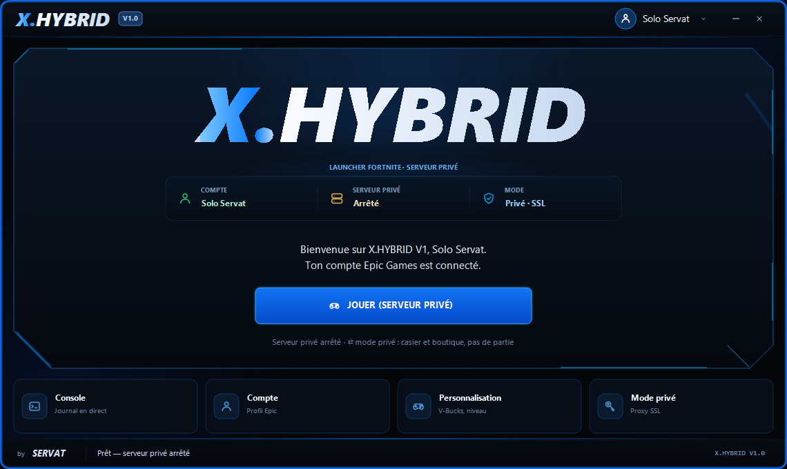
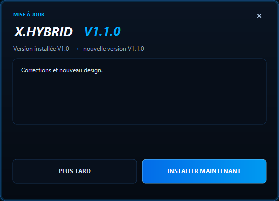

# X.HYBRID V1

Launcher Fortnite pour serveur privé (LawinServer), interface noir / bleu électrique,
session Epic persistante et **mises à jour automatiques** depuis les releases de ce dépôt.



## Télécharger

[**Dernière release**](https://github.com/tiktokservat7-stack/X.HYBRID/releases/latest) →
`X.HYBRID V1.exe`.

- **Un seul fichier** : aucune DLL à côté, BouncyCastle est embarqué.
- Nécessite **.NET Framework 4.8** (présent sur Windows 10/11).
- L'application demande l'élévation administrateur (fichier `hosts` + proxy SSL).
- Exe non signé : SmartScreen peut demander « Informations complémentaires » →
  « Exécuter quand même ».

Au lancement, le launcher vérifie les releases GitHub. Si une version plus récente
existe, il propose de l'installer, affiche la progression, se ferme, remplace son exe,
redémarre la nouvelle version et supprime l'ancienne. **La session Epic est conservée.**



## Fonctionnalités

- Connexion Epic par code d'activation (aucun mot de passe stocké).
- Jetons de session chiffrés avec DPAPI, restauration automatique au démarrage.
- Lancement de Fortnite via Epic Games Launcher, en ligne ou en mode privé.
- Proxy SSL local + redirection `hosts` vers LawinServer.
- Profil du serveur privé : V-Bucks, niveau, pseudo.
- Console intégrée, notifications Windows.
- Un seul exe, mises à jour GitHub.

## Compiler

```bat
cd FNHybridLauncher
dotnet build FNHybridLauncher.csproj -c Release -o bin/staging
```

Le fichier produit est `X.HYBRID V1.exe`. Test rapide du chiffrement embarqué :

```bat
"X.HYBRID V1.exe" --self-test
```

## Données locales

```
%APPDATA%\FNHybrid\        comptes, préférences, journaux
```

Aucun jeton n'est écrit dans le dépôt ni dans le dossier de l'application.

## Serveur privé

Le serveur n'est pas inclus : il est fourni par
[LawinServer](https://github.com/Lawin0129/LawinServer) (GPLv3). Le launcher le
détecte dans les emplacements habituels (`LawinServer` à côté du launcher, ou
`%APPDATA%\FNHybrid\config.json`).

## Mises à jour

Voir [HEBERGEMENT.md](HEBERGEMENT.md) : dépôt, tags, release, sécurité.

## Avertissement

Projet communautaire non affilié à Epic Games. Utilise ton propre compte et ton
propre serveur. Les marques citées appartiennent à leurs propriétaires.
